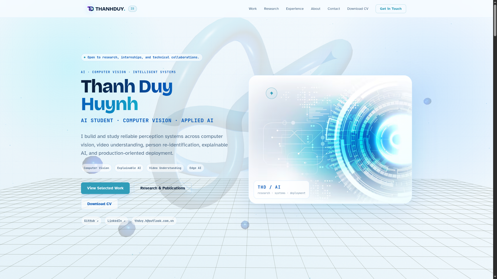
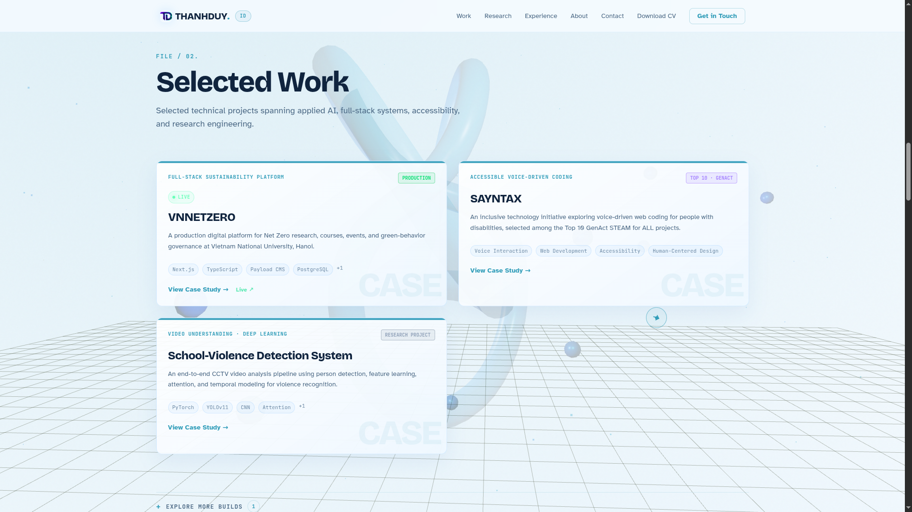
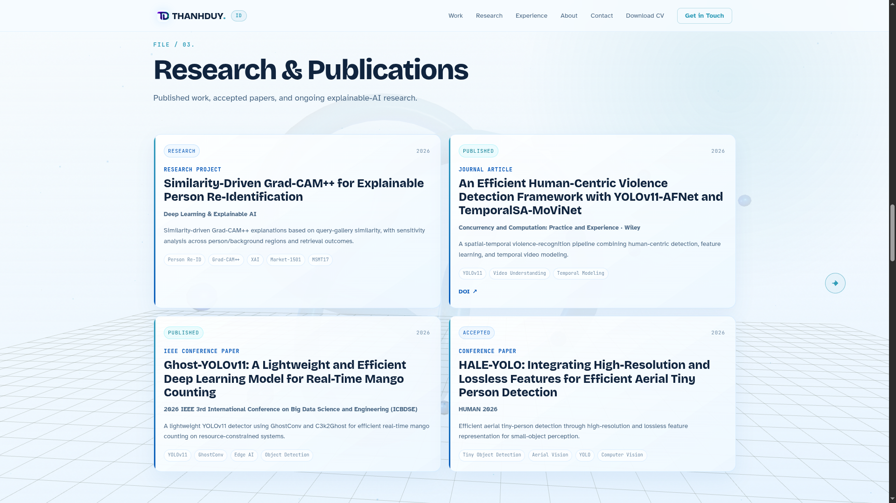

# Thanh Duy Huynh — Modern Portfolio

> Futuristic AI / Computer Vision portfolio built with Astro, React, GSAP, Three.js, and Tailwind CSS.

<p align="center">
  
</p>

<p align="center">
  
  
  
  
  
</p>

<p align="center">
  <b>AI · Computer Vision · Research · Interactive Web</b>
</p>

A modern personal portfolio for **Thanh Duy Huynh**, designed around a clean blue-and-white futuristic visual system and focused on research, computer vision, applied AI, technical projects, and real-world engineering experience.

## Overview

This portfolio showcases:

- Computer Vision research
- Explainable AI
- Video Understanding
- Person Re-Identification
- Edge AI & Intelligent Systems
- Full-stack development
- Research publications
- Technical leadership and selected achievements

The site uses a motion-heavy interactive design while keeping portfolio content separated into typed data files for easier maintenance.

## Tech Stack

- **Astro 6**
- **React 19**
- **TypeScript**
- **Tailwind CSS 4**
- **Three.js**
- **React Three Fiber**
- **React Three Drei**
- **GSAP**
- **Lenis**
- **Motion**

Astro is used as the main framework, while React powers interactive islands, 3D elements, and motion-rich sections.

## Project Structure

```text
src/
├── components/
│   ├── layout/
│   ├── sections/
│   ├── interactive/
│   └── ui/
├── data/
│   ├── site.ts
│   ├── projects.ts
│   ├── publications.ts
│   ├── experience.ts
│   ├── awards.ts
│   └── capabilities.ts
├── pages/
├── styles/
└── types/

public/
├── assets/
├── favicon.ico
└── ...
```

## Selected Projects

### VNNETZERO
**Full-Stack Developer — Vietnam National University, Hanoi**

A production platform for publishing Net Zero research, courses, events, sustainability content, and green behavior governance initiatives.

**Stack:** Next.js · TypeScript · Payload CMS · PostgreSQL · Docker · Linux

### SAYNTAX
**Project Lead — GenAct “STEAM for ALL” Top 10**

An accessibility-focused initiative exploring voice-driven web development for people with disabilities.

**Focus:** Voice Interaction · Accessibility · Human-Centered Design · Web Development

### School-Violence Detection System

An end-to-end CCTV video analysis pipeline using person detection, feature extraction, attention mechanisms, and temporal modeling.

### Person Re-Identification

Research involving OSNet, MDHA attention, and Dynamic Graph Convolution for cross-camera person retrieval and analysis.

## Research & Publications

### Similarity-Driven Grad-CAM++ for Explainable Person Re-Identification

A similarity-driven Grad-CAM++ framework that generates visual explanations directly from query-gallery similarity scores rather than class logits.

The research includes:

- true-positive and false-positive retrieval analysis
- Market-1501 and MSMT17 evaluation
- ResNet50 and MobileNetV2 backbones
- person/background attribution analysis
- perturbation-based sensitivity evaluation

### Human-Centric Violence Detection

Spatial-temporal video recognition using YOLOv11-based person detection, AFNet feature learning, and TemporalSA-MoViNet.

Published in **Concurrency and Computation: Practice and Experience — Wiley**.

### Ghost-YOLOv11

A lightweight YOLOv11-based detector for real-time mango counting using GhostConv and C3k2Ghost modules.

Published as an IEEE conference paper in 2026.

### HALE-YOLO

Research on high-resolution and lossless feature representation for aerial tiny-person detection.

Accepted conference paper, 2026.

## Design Direction

The portfolio follows a custom visual identity built around:

- clean white surfaces
- electric blue accents
- controlled cyan highlights
- dark navy contrast sections
- subtle glow effects
- futuristic interface details
- smooth motion and 3D interactions

The goal is to keep the design technical and modern without overwhelming the content.

## Local Development

Requirements:

- Node.js 22.12+
- npm

Install dependencies:

```bash
npm install
```

Start development server:

```bash
npm run dev
```

Create a production build:

```bash
npm run build
```

Preview the production build:

```bash
npm run preview
```

If available in the project, run the verification script before deployment:

```bash
npm run verify
```

Production output is generated in:

```text
dist/
```

## Deployment

The site can be deployed as a static Astro build on platforms such as:

- Vercel
- Cloudflare Pages
- Netlify
- GitHub Pages

Typical production settings:

```text
Build command: npm run build
Output directory: dist
Node.js: 22.12+
```

## Content Management

Portfolio content is intentionally separated from UI components.

To update personal information, projects, publications, experience, awards, or capabilities, edit the corresponding files under:

```text
src/data/
```

This makes it possible to update portfolio content without rewriting the section components.

## Planned Improvements

Future iterations may include:

- horizontal-scroll project sections
- pinned GSAP transitions
- custom section-by-section motion systems
- richer publication detail views
- interactive research visualizations
- improved project case-study pages
- expanded 3D interactions

## Preview

<p align="center">
  
  
</p>

## Contact

**Thanh Duy Huynh**

- GitHub: [@thduy-h](https://github.com/thduy-h)
- LinkedIn: [thduyh](https://www.linkedin.com/in/thduyh)

Open to research collaborations, AI engineering internships, computer vision projects, and technical collaborations.

## Credits

Portfolio content, branding, research information, customization, and continued development by **Thanh Duy Huynh**.

